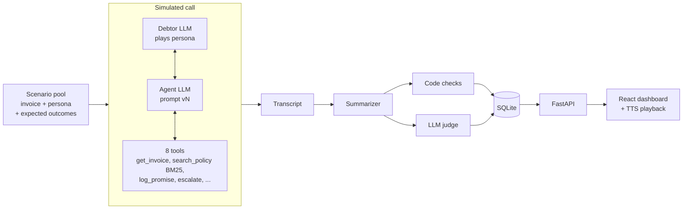

# CollectionsLab

[](https://github.com/namyaa6/CollectionsLab/actions/workflows/ci.yml)

An evaluation harness for AI collections voice agents. It simulates calls between
an agent and difficult synthetic debtors, grades every call with code checks and
an LLM judge, and compares prompt versions with measured numbers and 95%
confidence intervals.

## Demo

- **TODO:** 2-minute demo video: [link](TODO)
- **TODO:** live dashboard (GitHub Pages): [link](TODO)

**TODO:** hero screenshot: ``

## The problem

A voice agent's behaviour lives mostly in its prompt, and the prompt changes all
the time. Each change can cause:

- **Silent regressions:** fixing one kind of caller breaks another.
- **Wrong facts:** an amount or date that isn't in the invoice record.
- **TTS failures:** text that reads fine but breaks when spoken ("₹", digits, codes, long turns).
- **Missed escalations and compliance slips:** pressure, threats, ignoring a legal threat.

Reading a few transcripts by hand misses rare failures and gives you no numbers.

## Headline results

Same fixed scenario pool and seed for every version.

| Metric | v1 | v2 | v3 | v4 |
|---|---|---|---|---|
| Voice violations per call (code) | 8.93 | 0.36 | TODO | TODO |
| Identity verified before amounts (judge) | 7/14 (50%) | 14/14 (100%) | TODO | TODO |
| Task success (judge) | 14/14 | 12/14 | TODO | TODO |
| Hallucination (judge) | 0/14 | 1/14 | TODO | TODO |
| Compliance violation (judge) | 0/14 | 1/14 | TODO | TODO |
| Policy violations per call (code) | 0.00 | 0.07 | TODO | TODO |
| Outcome check (code) | 14/14 | 14/14 | TODO | TODO |

**Preliminary:** the v1 and v2 numbers were graded by judge prompt j1 (n=14, seed 42).
The final table will be graded by j2 for all versions. **TODO:** replace with final
j2 numbers (n=TODO) and add CIs. v2's 12/14 task success includes two known judge
false positives (see findings).

| Version | What changes |
|---|---|
| v1 | Naive: "polite collections agent, collect payment" |
| v2 | + voice rules: 1-2 short sentences, no symbols, amounts and dates in words |
| v3 | + grounding and guardrails: facts only from tools, verify identity, consult policy, safety rules in the prompt |
| v4 | v3's prompt word for word, + a self-check call that reviews each draft reply before it is spoken |

Each version changes one category of thing so a metric change can be traced to it.

## How it works



Every call is graded by two independent layers:

| Layer | What it checks | Good at |
|---|---|---|
| Code checks | Voice linter, fact checker (amounts and dates vs invoice), policy rules (installment limits, 30/60-day windows), outcome vs expected | Exact rules, numbers, dates. Deterministic and free. |
| LLM judge | Task success, hallucination, compliance, escalation, identity verified before amounts, pressure, tone. Each verdict needs a quote, which code checks really appears in the transcript. | Meaning and order ("asked who it was, then waited"), tone, judgment |

**Why both:** in the v2 audit each layer caught a real error the other missed.
Code owns numbers and dates; the judge owns language and judgment.

The judge never sees the persona, expected outcome or code-check results. Agent,
debtor simulator and judge all use `gemini-3.5-flash-lite` (a free-tier constraint),
so the judge is validated against hand labels and a second model rather than trusted.

## Key findings so far

- **A voice rule fixed identity verification (50% → 100%).** v2 has no identity
  rule. v1 asked "am I speaking with...?" and stated the amount in the same breath;
  v2's "short turn, then stop" rule leaves room for an answer. Wilson intervals
  27-73% vs 78-100% don't overlap. The cause is a hypothesis; v3 adds an explicit rule.
- **Clean speech, invented amount (call #3, disputes amount).** v2 sounded right and
  verified identity, then said "thirty-five thousand rupees" before calling
  `get_invoice`. The real figure is ₹1,70,300. Voice metrics can't see this; the judge
  and fact checker flagged it.
- **The judge is weak at date arithmetic; code is strong there.** The judge failed two
  promises exactly on day 30 (allowed), and missed an installment 69 days out (limit 60)
  that the code check caught. One "evidence" quote was policy text, not speech. This
  led to judge j2: explicit cutoff dates, inclusive boundaries, transcript-only quotes.
  **TODO:** whether j2 removes these errors.
- **Retrieval breaks on paraphrase.** Hand-written BM25Plus found the right policy
  section at top-1 for 5/6 tuning queries but only **1/5 held-out** paraphrases
  ("swearing" vs "abusive"). So safety-critical rules go in the prompt; the misses are
  kept as strict-xfail tests.
- **Ceiling effect.** The outcome check passes 14/14 for v1 and v2, so on this scenario
  set gains show up in voice and identity, not outcomes. The debtors may be too easy.
- **Code over-flags facts.** All 17 of v1's "unverified facts" were correct on audit
  (computed installment splits, relative dates), so they're treated as "needs review".

## Judge validation

Built: a blind labelling CLI (shows only what the judge saw, no version or persona),
per-criterion % agreement and Cohen's kappa (kappa because rare events like
hallucination make raw agreement look good by chance), tone compared by exact,
within-1 and mean difference, and a cross-judge check that re-judges the same 20 calls
with a second model (stored separately, never as the main verdict).

**TODO:** results (20 hand-labelled calls, judge j2; second model: TODO)

| Criterion | Judge vs me (agree / κ) | Second judge vs me | Judge vs second judge |
|---|---|---|---|
| Task success | TODO | TODO | TODO |
| Hallucination | TODO | TODO | TODO |
| Compliance | TODO | TODO | TODO |
| Identity verified | TODO | TODO | TODO |
| Pressure | TODO | TODO | TODO |
| Tone (exact / within 1 / mean diff) | TODO | TODO | TODO |

## Dashboard

- **Runs:** every run with prompt version, judge version, complete/partial status and headline rates.
- **Compare:** bar charts with 95% CI whiskers, and a "key changes" strip that calls a change "clear" only when intervals don't overlap.
- **Transcript viewer:** chat view with tool calls, lint problems marked on the exact words, judge evidence highlighted in place, a switcher to the same scenario in another run, and browser TTS playback so you can hear v1's "₹" and digits.

**TODO:** screenshots: `docs/screenshots/runs.png`, `compare.png`, `transcript.png`

## Engineering details

- **Resumable runner:** a run is keyed by a hash of prompt file, judge prompt, models, scenario pool and seed (CRLF-normalised so Windows and Linux agree). Interrupt anytime; rerun skips finished calls; a larger `--n` extends the run.
- **One LLM client:** disk cache, rate limiting, exponential backoff, and a clean stop on daily-quota exhaustion (verified on a real one).
- **Wilson confidence intervals** on every rate, overall and per persona.
- **Blind hand labelling** and a read-only database for the API and validation tools.
- **Summarizer cross-check:** logged tool actions vs an LLM's reading of the dialogue alone; disagreements are recorded, not hidden.
- **Tests:** 455 backend (plus 7 strict xfails for known limits) and 46 frontend. **TODO:** refresh counts. Unit tests never call the real API.
- **CI:** GitHub Actions runs pytest, vitest, typecheck and build on every push.

## What I'd do next

- **Hard scenario set** to break the ceiling: discount demands, the wrong person answering, payment claims without a UTR.
- **Hybrid retrieval** (BM25 + embeddings, Reciprocal Rank Fusion), measured on a fresh held-out set.
- **A stronger, independent judge model** from outside the agent's model family.
- **Real audio:** TTS + ASR in the loop, with latency testing.

## Limitations

- **Synthetic debtors:** LLM-played personas, possibly easier than real callers (see ceiling effect).
- **Same model everywhere:** agent, simulator and judge are all `gemini-3.5-flash-lite`, so the judge may share the agent's blind spots.
- **Small n:** 14 calls per version; most intervals are wide and most differences are within noise.
- **Free tier:** daily quotas decided the model choice and the sample size.
- **Text only:** no real audio, ASR, telephony or voice latency. TTS is the browser's Web Speech API.
- **Keyword retrieval:** BM25 misses paraphrases; the fact checker can't do arithmetic or resolve relative dates.

## How to run

Windows / PowerShell, Python 3.13, Node 22.

```powershell
python -m venv .venv
.venv\Scripts\activate
pip install -r requirements.txt
copy .env.example .env    # then set GEMINI_API_KEY, AGENT_MODEL, SIM_MODEL, JUDGE_MODEL
pytest -q
```

On Mac/Linux, use `source .venv/bin/activate` and `cp .env.example .env` instead.

One simulated call, then a small eval run (keep n small on the free tier):

```powershell
python -m backend.sim.run_one --scenario 0 --prompt v1
python -m backend.eval.runner --prompt v1 --n 5 --seed 42
```

Dashboard (API in one terminal, frontend in another):

```powershell
uvicorn backend.main:app --reload
cd frontend
npm install
npm run dev
```

Judge validation: `python -m backend.eval.label`, `python -m backend.eval.agreement`,
`python -m backend.eval.cross_judge --judge-model <model>`, `python -m backend.eval.export`.

All data is synthetic. No real people, companies, phone numbers or emails.
