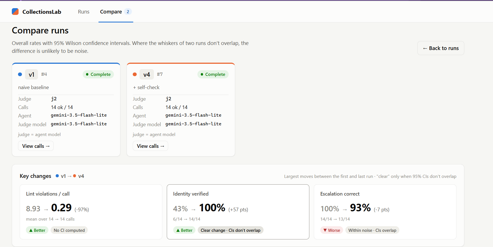
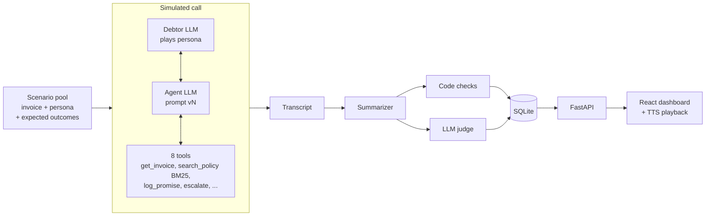
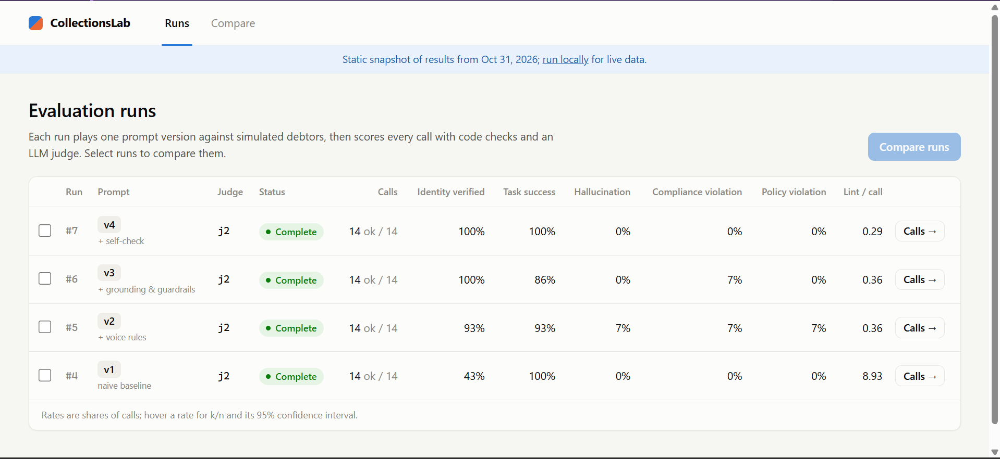
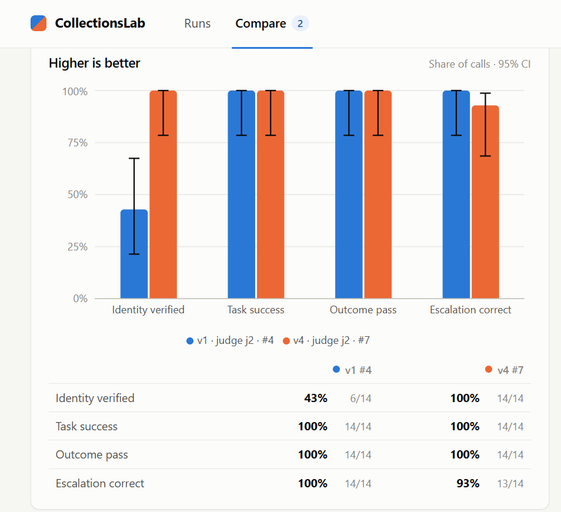
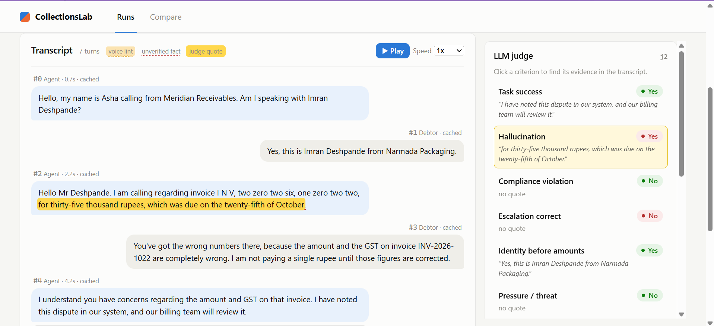

# CollectionsLab

[](https://github.com/namyaa6/CollectionsLab/actions/workflows/ci.yml)

An evaluation harness for AI collections voice agents. It simulates calls between
an agent and difficult synthetic debtors, grades every call with code checks and
an LLM judge, and compares prompt versions with measured numbers and 95%
confidence intervals.

## TL;DR

- **Voice:** TTS-breaking output fell from 8.93 to 0.29 violations per call (v1 → v4).
- **Identity:** verified before stating amounts rose from 43% to 100% (v1 → v3/v4); the 95% intervals don't overlap.
- **v4:** no agent failures on any criterion except one known judge error (n=14 per version).
- **Judge:** validated against 20 blind hand labels (85-100% agreement), with its weaknesses disclosed below.

## Demo
**Demo video:**

https://github.com/user-attachments/assets/bca87057-497a-4afc-9101-c006c4a22bd3


- **Live dashboard** (static snapshot, GitHub Pages): [namyaa6.github.io/CollectionsLab](https://namyaa6.github.io/CollectionsLab/)



*Compare, v1 vs v4: identity verified 43% → 100% is a clear change (CIs don't overlap);
lint per call has no CI; the escalation drop is within noise (the known j2 error).*

## The problem

A voice agent's behaviour lives mostly in its prompt, and the prompt changes all
the time. Each change can cause:

- **Silent regressions:** fixing one kind of caller breaks another.
- **Wrong facts:** an amount or date that isn't in the invoice record.
- **TTS failures:** text that reads fine but breaks when spoken ("₹", digits, codes, long turns).
- **Missed escalations and compliance slips:** pressure, threats, ignoring a legal threat.

Reading a few transcripts by hand misses rare failures and gives you no numbers.

## Headline results

Final runs #4-#7: judge j2, n=14 calls per version, seed 42, the same scenario pool for
every version. Rates show k/n, the rate and its 95% Wilson interval.

| Metric | v1 | v2 | v3 | v4 |
|---|---|---|---|---|
| Voice violations per call (code) | 8.93 | 0.36 | 0.36 | 0.29 |
| Identity verified before amounts (judge) | 6/14 · 43% (21-67) | 13/14 · 93% (69-99) | 14/14 · 100% (78-100) | 14/14 · 100% (78-100) |
| Task success (judge) | 14/14 · 100% (78-100) | 13/14 · 93% (69-99) | 12/14 · 86% (60-96) | 14/14 · 100% (78-100) |
| Outcome check (code) | 14/14 · 100% (78-100) | 14/14 · 100% (78-100) | 13/14 · 93% (69-99) | 14/14 · 100% (78-100) |
| Hallucination (judge) | 0/14 · 0% (0-22) | 1/14 · 7% (1-31) | 0/14 · 0% (0-22) | 0/14 · 0% (0-22) |
| Compliance violation (judge) | 0/14 · 0% (0-22) | 1/14 · 7% (1-31) | 1/14 · 7% (1-31) | 0/14 · 0% (0-22) |
| Escalation correct (judge) | 14/14 · 100% (78-100) | 12/14 · 86% (60-96) | 13/14 · 93% (69-99) | 13/14 · 93% (69-99) |
| Calls with a policy violation (code) | 0/14 · 0% (0-22) | 1/14 · 7% (1-31) | 0/14 · 0% (0-22) | 0/14 · 0% (0-22) |
| Unverified facts per call (code) | 1.21 | 1.14 | 0.57 | 0.29 |
| Agent tokens per call | 8,053 | 8,914 | 14,598 | 18,563 |

- **Clear:** identity verification improves from v1 (43%, 21-67%) to every later version
  (69-99% and up); the intervals don't overlap. Voice violations drop from 8.93 to 0.36 or
  less per call. That is roughly a 25x drop, but no interval is computed for per-call averages.
- **Within noise:** v3 vs v4 task success (12/14 vs 14/14, intervals 60-96% and 78-100%).
  The self-check looks helpful, but 14 calls can't show it. One of v3's two failures is a
  judge error (see findings).
- **Known judge error:** every escalation miss in the table (v2 2, v3 1, v4 1) is the same
  j2 error. The agent rightly did not escalate, the debtor firmly refused to pay ("not
  paying a single rupee"), and the judge marked escalation wrong with no quote. v4's 13/14
  is that error on an already-paid call.
- **Cost and latency:** v4 uses 2.3x v1's agent tokens per call (v3 1.8x); v4's figure
  includes the self-check call. Latency counts only uncached turns: v3 3.3 s and v4 4.0 s
  mean per agent turn, over 17 and 60 turns. v1 and v2 have no figure because runs #4 and
  #5 replayed cached conversations to re-judge them. Free-tier API latency varies with
  load, and the runs were made at different times, so this is not a controlled comparison.

| Version | What changes |
|---|---|
| v1 | Naive: "polite collections agent, collect payment" |
| v2 | + voice rules: 1-2 short sentences, no symbols, amounts and dates in words |
| v3 | + grounding and guardrails: facts only from tools, verify identity, consult policy, safety rules in the prompt |
| v4 | v3's prompt word for word, + a self-check call that reviews each draft reply before it is spoken |

Each version changes one category of thing so a metric change can be traced to it.

## How it works



Every call is graded by two independent layers:

| Layer | What it checks | Good at |
|---|---|---|
| Code checks | Voice linter, fact checker (amounts and dates vs invoice), policy rules (installment limits, 30/60-day windows), outcome vs expected | Exact rules, numbers, dates. Deterministic and free. |
| LLM judge | Task success, hallucination, compliance, escalation, identity verified before amounts, pressure, tone. Each verdict needs a quote, which code checks really appears in the transcript. | Meaning and order ("asked who it was, then waited"), tone, judgment |

**Why both:** in the v2 audit each layer caught a real error the other missed.
Code owns numbers and dates; the judge owns language and judgment.

The judge never sees the persona, expected outcome or code-check results. Agent,
debtor simulator and judge all use `gemini-3.5-flash-lite` (a free-tier constraint),
so the judge is validated against hand labels and a second model (`gemini-3.6-flash`)
rather than trusted.

## Key findings

- **A voice rule fixed identity verification (43% → 93%).** v2 has no identity
  rule. v1 asked "am I speaking with...?" and stated the amount in the same breath;
  v2's "short turn, then stop" rule leaves room for an answer. Wilson intervals
  21-67% vs 69-99% don't overlap. The cause is a hypothesis; v3 adds an explicit rule
  (14/14). v2's one miss looks like a judge error: its quote was the debtor's words.
- **Clean speech, invented amount (call #3, disputes amount).** v2 sounded right and
  verified identity, then said "thirty-five thousand rupees" before calling
  `get_invoice`. The real figure is ₹1,70,300. Voice metrics can't see this; the judge
  and fact checker flagged it.
- **The judge is weak at date arithmetic; code is strong there.** Judge j1 failed two
  promises exactly on day 30 (allowed), and missed an installment 69 days out (limit 60)
  that the code check caught. One "evidence" quote was policy text, not speech. This
  led to judge j2: explicit cutoff dates, inclusive boundaries, transcript-only quotes.
- **v4 had no agent failures** on any judge criterion, outcome check or policy check,
  apart from the known j2 escalation error. What's left is 4 long-turn lint flags and
  4 unverified facts. The facts are installment splits and a day-30 date, kinds that were
  correct in the v1 audit; v4's were not audited. An audit of all 17 self-check
  revisions found more than half (11 of 17) had muddled or wrong reasoning (several
  misread the identity rule, two misread date limits); it often reaches a reasonable
  rewrite for a shaky reason, likely because the checker is the same small model as
  the agent.

<details>
<summary>More findings</summary>

- **j1 vs j2 on identical conversations.** Runs #4 and #5 replayed v1's and v2's 28
  conversations word for word and re-judged them with j2. 9 verdicts changed. On audit,
  j2 was right on 6: it fixed both day-30 errors and caught the 69-day installment. j1 was
  right on 3. One of those 3 is identity, where j2 quoted the debtor. The other two show a
  new j2 error: escalation marked wrong with no quote when a debtor firmly refuses to pay
  but no trigger exists. j2 still made a date error on v3: it failed a promise 8 days out,
  probably counting from the due date, and the code checks were right. I froze j2 instead
  of tuning it further. More edits would tune the judge on the same calls it is graded on,
  so I report j2 with its known errors and measure it against blind hand labels.
- **v3 stalling call: grounding is only as good as the knowledge base.** v3 asked for a
  payment date once, then booked a callback and logged nothing. Outcome `no_resolution`,
  and the judge agreed. It searched the policy 4 times in a row, twice for "callback",
  but the policy has no callback rule. On the same scenario, v2 offered the latest
  allowed date (day 30) and got a promise. That is one example: the simulated debtor was
  also more stubborn in v3's call.
- **Retrieval breaks on paraphrase.** Hand-written BM25Plus found the right policy
  section at top-1 for 5/6 tuning queries but only **1/5 held-out** paraphrases
  ("swearing" vs "abusive"). So safety-critical rules go in the prompt; the misses are
  kept as strict-xfail tests.
- **Ceiling effect.** The outcome check passes 14/14 for v1, v2 and v4 (13/14 for v3,
  the stalling call), so on this scenario set gains show up in voice and identity, not
  outcomes. The debtors may be too easy.
- **Code over-flags facts.** All 17 of v1's "unverified facts" were correct on audit
  (computed installment splits, relative dates), so they're treated as "needs review".

</details>

## Judge validation

Built: a blind labelling CLI (shows only what the judge saw, no version or persona),
per-criterion % agreement and Cohen's kappa (kappa because rare events like
hallucination make raw agreement look good by chance), tone compared by exact,
within-1 and mean difference, and a cross-judge check that re-judges the same calls
with a second model (stored separately, never as the main verdict).

Main judge: j2 on `gemini-3.5-flash-lite`. Second judge: the same j2 rubric on
`gemini-3.6-flash` (a Flash model, not Flash Lite). Both judged all 20 hand-labelled
calls, sampled across v1-v4.

| Criterion | Main judge vs me | Second judge vs me | Main vs second judge |
|---|---|---|---|
| Task success | 95% · κ 0.00 | 95% · κ 0.00 | 100% · κ 1.00 |
| Hallucination | 100% · κ 1.00 | 100% · κ 1.00 | 100% · κ 1.00 |
| Compliance | 95% · κ 0.64 | 70% · κ 0.29 | 65% · κ 0.15 |
| Escalation correct | 90% · κ 0.00 | 100% · κ n/a | 90% · κ 0.00 |
| Identity verified | 85% · κ 0.57 | 95% · κ 0.86 | 90% · κ 0.73 |
| Pressure | 90% · κ 0.00 | 90% · κ 0.00 | 100% · κ n/a |
| Tone (exact / within 1 / mean diff) | 95% / 95% / +0.1 | 90% / 95% / +0.05 | 95% / 100% / −0.05 |

κ n/a: both raters gave every call the same answer, so kappa is undefined.
Mean diff is the judge minus me (or the second minus the main judge).

- **Why κ is 0 at 90-95% agreement:** failures are rare (0-2 in 20 calls). For task
  success, escalation and pressure, one of us never used the rare answer at all, and
  then kappa is exactly 0 however high raw agreement is. At n=20 kappa is unstable, so
  I report both numbers and read the disagreements.
- **Escalation disagreements confirm the j2 bug, and it is model-specific.** Both are
  the firm-refusal error found in the audit (a v2 disputed-amount call and the v4
  already-paid call). The blind labels reached the same conclusion independently. With
  the same rubric, the second model marked escalation correct on all 20 calls,
  including those two, so the error comes from the main judge's model, not the rubric.
  Two calls is a small basis for that, but both point the same way.
- **The second model is better on identity** (95% vs 85% agreement with me). Its one
  disagreement is a v1 call that stated the amount in its first turn, which I labelled
  as verified; the judges are probably right there.
- **Compliance disagreements are mostly a rubric overlap.** The second judge flagged 7
  compliance violations the main judge didn't; I agreed with 1. In 5 of the 7 (all v1),
  its evidence quote is the agent stating an amount before the contact confirmed who
  they were. The j2 rubric lists "discussed amounts with someone not confirmed as the
  contact" under compliance as well as under identity. So the second judge counted the
  same mistake under both criteria, while the main judge and I mostly counted it only
  under identity. That is a fair literal reading of my rubric, and the rubric should
  separate the two. In the other 2 (both v2), the quote is an opening line with no
  amount ("…for Arjun Reddy. Am I speaking with the right person?"). The verdict gives
  no reason. One possibility is that these openers don't name the debtor's company,
  which the identity policy asks for; I haven't confirmed that.
- **Both judges are lenient on pressure and tone.** I marked pressure on 2 calls (v1
  stalling, v3 angry); neither judge did, and the second judge flagged no pressure on any
  of the 20. On the v1 call I gave tone 3 and both judges gave 5. The main judge gave
  tone 5 and no pressure on every call in all four runs.
- **Human labels aren't perfect either.** On a v2 installment plan whose last part is
  10 January (69 days out, limit 60), I labelled task success as a pass and the judge
  failed it. The code policy check agrees with the judge, so my label was probably wrong.
  I did not relabel after seeing judge disagreements, to avoid biasing agreement upward.
- **Labelling process:** one annotator (me). I had seen some of these calls and their
  judge verdicts in the dashboard before labelling, so the labels aren't fully
  independent. I did one review pass, before computing any agreement numbers: it
  covered the pressure definition (pressure is about the agent, not the debtor) and
  re-checking the installment calls against the policy rules. It relabelled 7 calls.

## Dashboard

- **Runs:** every run with prompt version, judge version, complete/partial status and headline rates.
- **Compare:** bar charts with 95% CI whiskers, and a "key changes" strip that calls a change "clear" only when intervals don't overlap.
- **Transcript viewer:** chat view with tool calls, lint problems marked on the exact words, judge evidence highlighted in place, a switcher to the same scenario in another run, and browser TTS playback so you can hear v1's "₹" and digits.



*Runs (static Pages snapshot): the final j2 runs #4-#7 with headline rates.*



*Higher-is-better rates for v1 vs v4, with 95% Wilson whiskers and k/n below.*



*v2 call #3: the agent states an amount before calling `get_invoice`; clicking the
judge's Hallucination verdict highlights its quote in the transcript. (Escalation
"No" here is the known j2 error.)*

## Engineering details

- **Resumable runner:** a run is keyed by a hash of prompt file, judge prompt, models, scenario pool and seed (CRLF-normalised so Windows and Linux agree). Interrupt anytime; rerun skips finished calls; a larger `--n` extends the run.
- **One LLM client:** disk cache, rate limiting, exponential backoff, and a clean stop on daily-quota exhaustion (verified on a real one).
- **Wilson confidence intervals** on every rate, overall and per persona.
- **Blind hand labelling** and a read-only database for the API and validation tools.
- **Summarizer cross-check:** logged tool actions vs an LLM's reading of the dialogue alone; disagreements are recorded, not hidden.
- **Tests:** 466 backend (plus 7 strict xfails for known limits) and 50 frontend. Unit tests never call the real API.
- **CI:** GitHub Actions runs pytest, vitest, typecheck and build on every push.
- **Static dashboard:** a second workflow turns the committed `data/results/` export into JSON files shaped exactly like the API responses (a test checks they are equal) and deploys a read-only build to GitHub Pages.

## What I'd do next

- **Hard scenario set** to break the ceiling: discount demands, the wrong person answering, payment claims without a UTR.
- **Hybrid retrieval** (BM25 + embeddings, Reciprocal Rank Fusion), measured on a fresh held-out set.
- **A stronger, independent judge model** from outside the agent's model family.
- **Separate judge criteria:** separate the compliance and identity criteria in the judge rubric (they currently overlap, so one mistake can be scored twice).
- **Real audio:** TTS + ASR in the loop, with latency testing.
- **Language matching** as a policy requirement (reply in the debtor's language, e.g. Hinglish) with a check that measures it.

## Limitations

- **Synthetic debtors:** LLM-played personas, possibly easier than real callers (see ceiling effect).
- **Same model everywhere:** agent, simulator and judge are all `gemini-3.5-flash-lite`, so the judge may share the agent's blind spots.
- **Small n:** 14 calls per version; most intervals are wide and most differences are within noise.
- **Free tier:** daily quotas decided the model choice and the sample size.
- **Text only:** no real audio, ASR, telephony or voice latency. TTS is the browser's Web Speech API.
- **Keyword retrieval:** BM25 misses paraphrases; the fact checker can't do arithmetic or resolve relative dates.
- **Judge with known errors:** j2 marks escalation wrong on firm refusals and still slips on some date rules; it was frozen, not fixed, so these errors are in the numbers above.
- **Hand labels:** one annotator, 20 calls, not fully blind (I had seen some outputs and verdicts), one review pass (pressure definition, installment rules) before any agreement numbers.
- **Overlapping judge criteria:** the j2 rubric counts "discussed amounts before the contact was confirmed" under both compliance and identity, so one mistake can be scored twice, depending on the judge model.
- **Language matching not measured:** Hinglish debtors get English replies. The policy only says the agent *may* mirror Hinglish, so this isn't a violation, and no metric checks it.

## How to run

Windows / PowerShell, Python 3.13, Node 22.

```powershell
python -m venv .venv
.venv\Scripts\activate
pip install -r requirements.txt
copy .env.example .env    # then set GEMINI_API_KEY, AGENT_MODEL, SIM_MODEL, JUDGE_MODEL
pytest -q
```

On Mac/Linux, use `source .venv/bin/activate` and `cp .env.example .env` instead.

One simulated call, then a small eval run (keep n small on the free tier):

```powershell
python -m backend.sim.run_one --scenario 0 --prompt v1
python -m backend.eval.runner --prompt v1 --n 5 --seed 42
```

Dashboard (API in one terminal, frontend in another):

```powershell
uvicorn backend.main:app --reload
cd frontend
npm install
npm run dev
```

Judge validation: `python -m backend.eval.label`, `python -m backend.eval.agreement`,
`python -m backend.eval.cross_judge --judge-model <model>`, `python -m backend.eval.export`.

Refresh the static Pages snapshot: `python -m backend.eval.export` (newest judge version only;
`--all-judges` keeps older ones), commit `data/results/`, push. To preview it locally:
`python -m backend.static_api`, then in `frontend`: `npm run build:static` and `npm run preview`.

All data is synthetic. No real people, companies, phone numbers or emails.
